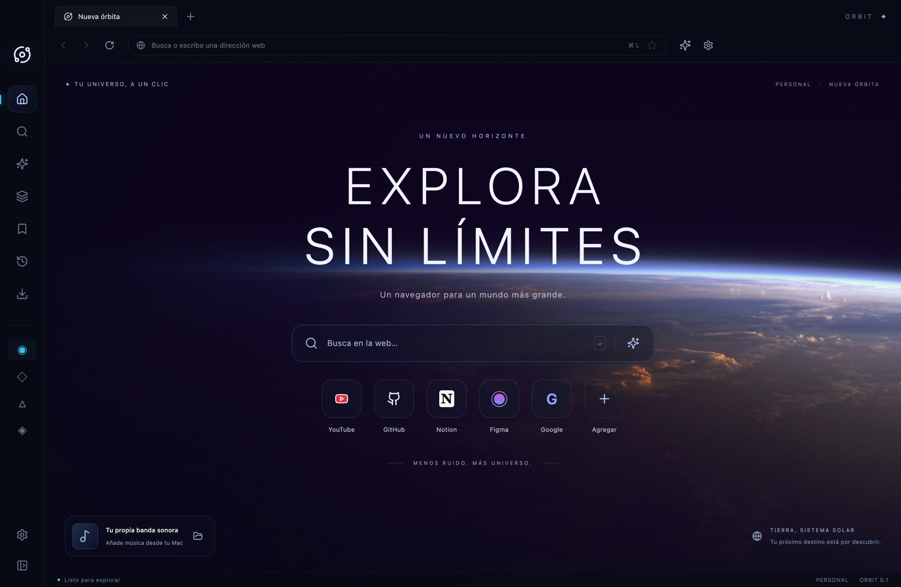

# ORBIT — Explora sin límites

Un navegador de escritorio para macOS con navegación real en Electron WebContentsView, una interfaz React/TypeScript y fondos cinematográficos.

[Ver la presentación](https://fuckshady.github.io/orbit-browser/) · [Descargar la alpha](https://github.com/fuckshady/orbit-browser/releases/tag/v0.1.0-alpha.1) · [Documentación técnica](orbit-browser/README.md)



## Qué incluye

- Navegación Chromium real sin iframes, pestañas y atajos.
- Espacios de trabajo con pestañas y marcadores independientes.
- Historial, marcadores y preferencias en SQLite.
- Gestor de descargas nativo y reproductor de audio local.
- Wallpapers de video 4K y galería conectada a Wallhaven.
- Cristal adaptativo con color automático del wallpaper o color manual, transparencia y desenfoque ajustables.
- Panel AI para conectar un proveedor compatible con Chat Completions; sin respuestas simuladas ni claves en el frontend.

## Ejecutar el navegador

Requiere Node.js 24+ y macOS. La entrega actual está compilada y comprobada para Apple Silicon.

```sh
cd orbit-browser
npm install
npm run dev
```

```sh
npm test
npm run build
```

`build` genera `orbit-browser/release/mac-arm64/ORBIT.app` en un Mac Apple Silicon. Consulta la documentación técnica para el resto de los comandos y limitaciones.

## Sitio público

`site/` contiene una presentación estática con capturas reales y una galería accesible. GitHub Pages publica exclusivamente esa carpeta mediante `.github/workflows/pages.yml`. El sitio no ejecuta Electron ni pretende ofrecer un navegador de escritorio dentro de una página web.

Para verlo localmente:

```sh
python3 -m http.server 8080 --directory site
```

## Estado de la descarga

**Alpha de desarrollo, sin firma Developer ID ni notarización de Apple.** macOS puede bloquearla. No es una versión estable ni un navegador auditado para uso sensible. El panel AI requiere proveedor y credenciales propios. No incluye sincronización, actualizaciones automáticas, extensiones ni DRM/Widevine.

Los paquetes descargables se publican como assets de GitHub Releases, fuera del historial de Git. El directorio `release/`, los datos personales, las bases SQLite, las credenciales y `node_modules` no se incluyen en el repositorio.

## Recursos visuales

Las imágenes y los clips incluidos proceden de los archivos suministrados para este proyecto. Las capturas muestran funciones reales de ORBIT. Los fondos elegidos por cada usuario desde Wallhaven permanecen en su directorio privado de datos y no se suben a este repositorio.
